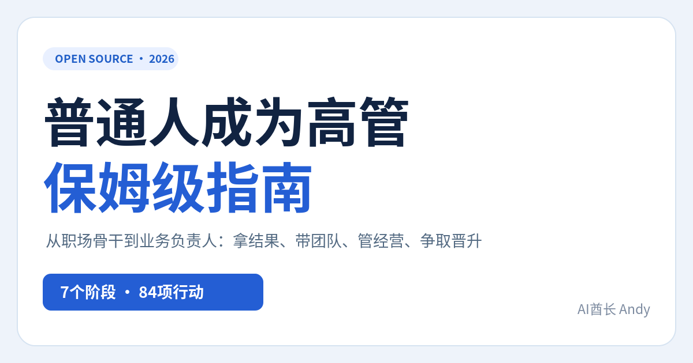
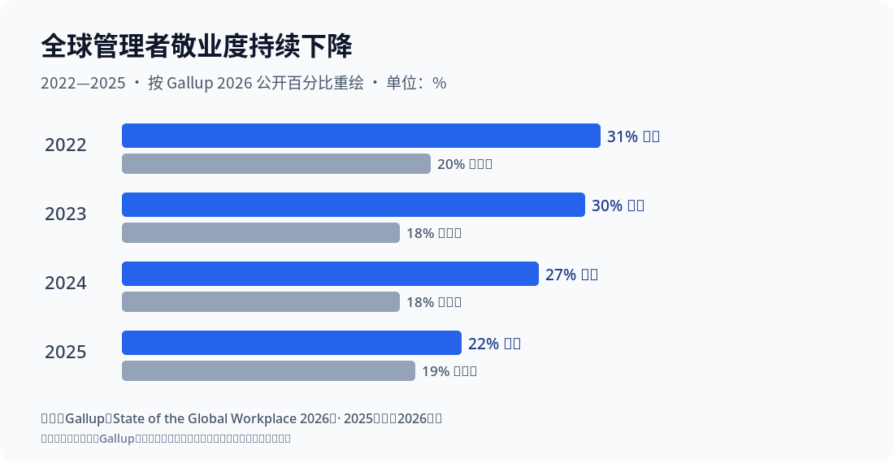

> **请先看这里：** 本仓库是旧版，已于 2026-10-16 存档并停止更新。正式版在 [AIPMAndy/how-to-become-an-executive](https://github.com/AIPMAndy/how-to-become-an-executive)，在线阅读：[https://aipmandy.github.io/how-to-become-an-executive/](https://aipmandy.github.io/how-to-become-an-executive/)。

<div align="center">

# 普通人成为高管保姆级指南

**How to Become an Executive｜从一个人做好工作，到带项目、带团队、经营业务的一套可执行开源手册**



**7个阶段 · 84项具体任务 · 10份专题SOP · 33份文本/CSV模板 + 1份Excel工作簿 · 14张原始证据卡（32条研究与法规线索）**

[**在线阅读与互动工具**](https://aipmandy.github.io/how-to-become-executive/) · [**GitHub 仓库**](https://github.com/AIPMAndy/how-to-become-executive) · [**打开离线阅读页**](index.html) · [**从零开始**](guides/00-start.html) · [**先做自己的定位**](playbooks/01-first-week.html) · [**高管晋升怎么谈**](playbooks/06-promotion-sponsor.html) · [**对抗式审核**](audit/ADVERSARIAL_REVIEW.html)

</div>

---

## 别急着学管理，先弄清楚你想负责什么

普通员工完成任务；骨干解决复杂问题；项目Owner协调资源承担一项结果；经理靠团队交付；业务负责人要对经营指标、资源分配和风险做判断。更高级的管理岗位则往往涉及组织方向、人才、战略取舍和治理责任。**这是一条方便读者理解的成长路线，不是任何企业统一的职级规定。**

《公司法》第265条定义的法定高级管理人员，包括公司的经理、副经理、财务负责人、上市公司董事会秘书和章程规定的其他人员。总监、VP等业务头衔不能自动推定为法定高管身份。[国家市场监督管理总局《公司法》原文](https://www.samr.gov.cn/xyjgs/flfg/art/2024/art_d4e84936a8a744f8928ac7aec7594345.html)。

本项目提供的是让读者**积累更大责任所需要的真实证据**的方法，不承诺晋升、薪酬、职级或耗时。新任主管的90天计划是管理动作的检查点，并非“90天当高管”。

## 这份指南终于有硬证据：原始研究、真实企业、反例

> 数据均取自发布者公开原文。**每个数字对应特定统计对象**，并非“完成本项目就能升职”的预测。全部14张证据卡见 [研究原文与反例图谱](evidence/RESEARCH_ATLAS.html)。

| 核验过的结论 | 出处与对象 | 可以得出的行动 | 不能推出的结论 |
|---|---|---|---|
| **75%** 的沃尔玛受薪经理从小时工起步 | [沃尔玛2026年官方文章](https://corporate.walmart.com/news/2026/06/29/bringing-new-career-paths-into-focus) | 查内部晋升机制、学历与技能路线 | “基层员工有75%概率当经理” |
| 内部流动最高企业的**人均领导晋升次数高79%** | [LinkedIn 2024企业观察](https://www.linkedin.com/business/talent/blog/talent-acquisition/how-internal-mobility-benefits-employers) | 查轮岗、内部竞聘、管理岗位机会 | “个人横向跳岗晋升率提升79%” |
| **335个独立样本**支持领导力培训总体有效 | [Lacerenza等2017年元分析](https://pubmed.ncbi.nlm.nih.gov/28749153/) | 做真实项目、反馈、间隔练习 | “参加课程即可升高管” |
| **近300名初任管理者、12类挑战** | [CCL2024研究](https://www.ccl.org/articles/leading-effectively-articles/first-time-managers-must-conquer-these-challenges/) | 补授权、反馈、团队协作 | “每名经理都会遭遇这12项” |
| **180个Google团队**识别五项相关因素 | [Google re:Work原始说明](https://rework.withgoogle.com/intl/en/guides/understand-team-effectiveness) | 建立清晰决策权、可靠协作 | “单靠心理安全可提升固定百分比绩效” |
| 2025年全球经理敬业度**22%** | [Gallup 2026全球职场报告](https://www.gallup.com/workplace/349484/leadership.aspx) | 升经理前评估资源、压力和组织环境 | “经理只有22%有能力”或“经理晋升率22%” |
| 研究覆盖**7800位CEO的历史数据库** | [McKinsey2019原始研究](https://www.mckinsey.com/capabilities/strategy-and-corporate-finance/our-insights/the-mindsets-and-practices-of-excellent-ceos) | 学习方向、资源、团队、治理取舍 | “基层员工需要成为小CEO” |



*本图按Gallup公开数据重绘，并非官方原图。指标是全球从业者自报的敬业度，不是晋升概率。*

[研究证据总览](evidence/RESEARCH_ATLAS.html) · [3个真实企业案例](evidence/CASE_STUDIES.html) · [图表数字与口径](evidence/DATA_VISUALIZATIONS.html) · [证据纠错规则](audit/EVIDENCE_AUDIT.html)

## 第一次看，照着做这6步

1. **打开 [3分钟路线](guides/00-start.html)**，对照自己的实际岗位而不是Title，选择管理路线或专家路线。
2. **找3份真实岗位JD**，核对责任、权限、人员、预算、业务指标和任命条件，形成对照表。
3. **写3张真实成果证据卡**：业务问题、基线、你的决策、他人贡献、结果、归因限制、必要脱敏。
4. **只选一种要扩大承担的责任**：跨部门项目、直接团队、预算/经营或治理问题；先取得相应授权。
5. **填90天计划**，为每项设具体结果、授权人、复盘日期和失败时的替代路径。
6. **每周对抗复盘**：“真是我决定的吗？”“换个口径还成立吗？”“组织有没有这个岗位？”“有没有不可逆的合规风险？”

从第一天就能填：[**综合操作工作簿（Excel）**](templates/普通人成为高管_完整实操工作簿.xlsx)。

前7天详细操作：[SOP01：普通人第一周](playbooks/01-first-week.html)。你的成果不需要夸张，**经得起追问比写得漂亮重要**。

## 七阶段路线

| 阶段 | 首要转变 | 能留下的证据 | 指南 |
|---|---|---|---|
| 01 职业定位 | 从认Title到认责任/机会 | 3份JD+双路线取舍 | [定岗位](guides/01-position.html) |
| 02 核心骨干 | 从完成任务到可核验业务结果 | 成果证据卡+复用SOP | [积累业绩](guides/02-expert.html) |
| 03 项目Owner | 从帮助执行到获得有限授权 | 章程、风险台账、止损记录 | [跨部门项目](guides/03-owner.html) |
| 04 团队经理 | 从个人救火到团队可持续交付 | 1对1、授权、绩效事实 | [带团队](guides/04-manager.html) |
| 05 业务负责人 | 从项目指标到经营取舍 | 经营数据、预算决策和风险 | [看经营](guides/05-business.html) |
| 06 高管候选 | 从资深经历到下一层岗位证据 | 五页晋升包和试任反馈 | [争取机会](guides/06-promotion.html) |
| 07 履新与治理 | 从取得Title到真实负责任职 | 30/60/90/180天滚动计划 | [履新](guides/07-onboard.html) |

## 十份“粉丝可以直接执行”的专题SOP

| 你现在碰到什么问题 | 直接打开 | 最终交付物 |
|---|---|---|
| 不知道自己能不能走管理线 | [01 第一周定位](playbooks/01-first-week.html) | 3张岗位JD卡、1份差距图 |
| 业绩很好却说不清价值 | [02 成果证据库](playbooks/02-impact-evidence.html) | 3张可质询成果卡 |
| 没有下属也想练管理 | [03 争取项目Owner](playbooks/03-owner-authority.html) | 授权章程、RACI、风险和止损条件 |
| 第一次从同事变经理 | [04 上任30天](playbooks/04-manager-first-30.html) | 团队目标、1对1、授权记录 |
| 被要求对业务结果负责 | [05 经营账](playbooks/05-financial-literacy.html) | 收入-成本-现金解释和资源取舍 |
| 不知道怎么争取晋升 | [06 晋升证据与试任](playbooks/06-promotion-sponsor.html) | 五页晋升包与反馈记录 |
| 接了总监/高管岗位 | [07 履新180天](playbooks/07-new-role-180.html) | 30/60/90/180天阶段成果 |
| 长期得不到机会 | [08 四种晋升困局](playbooks/08-career-stuck.html) | 能力/机会分离与备选路径 |
| 担心越权、法律、利益冲突 | [09 治理底线](playbooks/09-governance-ethics.html) | 岗位身份和风险升级记录 |
| 外部面试总监/VP | [10 面试与Offer尽调](playbooks/10-executive-interview.html) | 6类真实案例与尽调清单 |

### 三条细分路线

[AI产品与技术负责人](tracks/ai-product.html) · [产品/运营/销售负责人](tracks/product-operations.html) · [财务/HR/技术职能负责人](tracks/finance-hr-technology.html)。如果你更喜欢研究、开发和专业深度，**专家路线可以是长期选择**，不必为了Title强迫自己带团队。

## 可直接使用的模板

| 类型 | 示例 | 文件 |
|---|---|---|
| 成果归因 | 本人决策、他人贡献、统计口径 | [证据台账](templates/impact-ledger.csv) · [证据质量检验](templates/evidence-quality.html) |
| 项目管理 | 谁拍板、谁执行、升级与止损 | [项目章程](templates/project-charter.html) · [授权卡](templates/delegation-contract.html) · [风险CSV](templates/risk-register.csv) |
| 团队管理 | 1对1、授权、绩效反馈 | [1对1](templates/one-on-one.html) · [反馈话术](templates/feedback-1on1.html) · [会议节奏](templates/weekly-operating-rhythm.html) |
| 经营与判断 | 真实收入、毛利、回款、决策记录 | [经营模板](templates/business-review.html) · [口径检查](templates/finance-guardrails.html) · [决策日志](templates/decision-journal.csv) |
| 晋升与求职 | 岗位权限、试任、面试、Offer尽调 | [五页晋升包](templates/promotion-packet.html) · [晋升话术](templates/promotion-scripts.html) · [Offer核对](templates/offer-due-diligence.html) |
| 履新与风险 | 30/60/90天计划、法律治理、AI安全 | [90天计划](templates/90-day-plan.html) · [治理清单](templates/governance-checklist.html) · [AI使用边界](templates/ai-execution.html) |

**[一键获取综合工作簿（XLSX）](templates/普通人成为高管_完整实操工作簿.xlsx)**：7个工作表，包含岗位对照、成果证据、项目授权、经营数字示例、晋升材料及90天计划。全部 33 份 Markdown/CSV 模板也放在 `templates/`，其中CSV可以用 Excel、Numbers 等直接打开，空白栏由读者填写。**严禁将公司机密、个人薪酬记录、客户名单或绩效信息上传公开GitHub仓库。**

## 互动网页可以做什么

`index.html` 为无需安装的独立离线页面，支持按职业阶段筛选和搜索84张任务卡、展开操作与受阻处理、勾选进度、8维证据自评以及90天计划导出。自评是作者设计的**自查工具，不具有已验证的招聘预测效度**；不能用它决定是否录用、解雇或直接给人打绩效分。

```bash
python3 -m pip install -r requirements-dev.txt # 仅重建文档的开发者需要
python3 build.py                         # 重新生成互动HTML及独立阅读页
python3 -m unittest discover -s tests -v # 文档结构、来源、相对链接、构建检查
node tests/math.test.js                  # 可选：算法边界测试
```

*没有Python也能双击现成 `index.html` 查看交互版。阅读资料在各个`.html`文件中，可脱离GitHub单独阅读。*

## 调研依据与不能直接照搬的地方

- [CCL新经理挑战](https://www.ccl.org/articles/leading-effectively-articles/first-time-managers-must-conquer-these-challenges/)：个人贡献者转换为管理者时，授权与团队协作是典型困难。
- [CIPD 2026绩效管理](https://prod.cipd.org/en/knowledge/factsheets/performance-factsheet/)：绩效目标、频繁反馈和支持资源应形成连续过程。
- [CIPD 2025继任计划](https://prod.cipd.org/en/knowledge/factsheets/succession-planning-factsheet/)：组织岗位需求与实践培养同样重要。
- [Google团队研究](https://rework.withgoogle.com/intl/en/guides/understand-team-effectiveness)：讨论团队心理安全、清晰结构、可靠交付等因素，结论主要来自其组织研究背景。
- [McKinsey CEO职责框架](https://www.mckinsey.com/capabilities/strategy-and-corporate-finance/our-insights/the-mindsets-and-practices-of-excellent-ceos)：战略、组织、人才、董事会、外部沟通和个人效能。
- [中国《公司法》官方原文](https://www.samr.gov.cn/xyjgs/flfg/art/2024/art_d4e84936a8a744f8928ac7aec7594345.html)：任命、忠实勤勉、利益冲突及法定高管身份。

研究的样本与适用行业并不相同，这些资料提供研究线索，**不意味着完成84项任务就一定晋升**。逐条论证、样本、数字来源与不能外推的边界，见 [14张证据卡](evidence/RESEARCH_ATLAS.html)；补充参考文献见 [REFERENCES](REFERENCES.html)。对抗式审核与反例见 [审核报告](audit/ADVERSARIAL_REVIEW.html)。

## GitHub开放共建与服务边界

开放纠错、行业岗位实操、匿名化的失败复盘和可授权模板。欢迎指出任何“照着做仍做不了”的环节，并说明缺了什么权限、事实、资源或官方规定。

若需要求职、职业发展、管理跃迁或 AI 应用方面的个性化讨论，可自愿联系 **微信：AIPMAndy**，或访问 [Andy 个人官网](https://metaver.vip/)。咨询不承诺晋升或录用结果。**免费开源内容完整可用，不要求付费后才能看到核心方法。**不接收读者在公开Issue上传隐私或企业材料。

[贡献说明](CONTRIBUTING.html) · [发布步骤](PUBLISH.html) · [对抗审核](audit/ADVERSARIAL_REVIEW.html)

**项目发起：AI酋长 Andy。** 原创指南采用CC BY 4.0，原创程序代码采用MIT；外部研究版权归各机构所有。参考 [CONTENT_LICENSE](CONTENT_LICENSE.md)。
