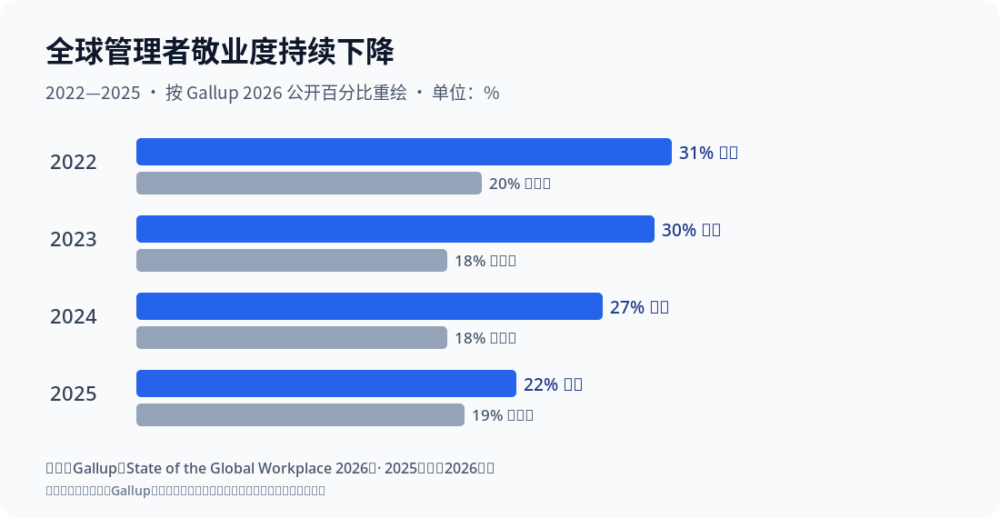
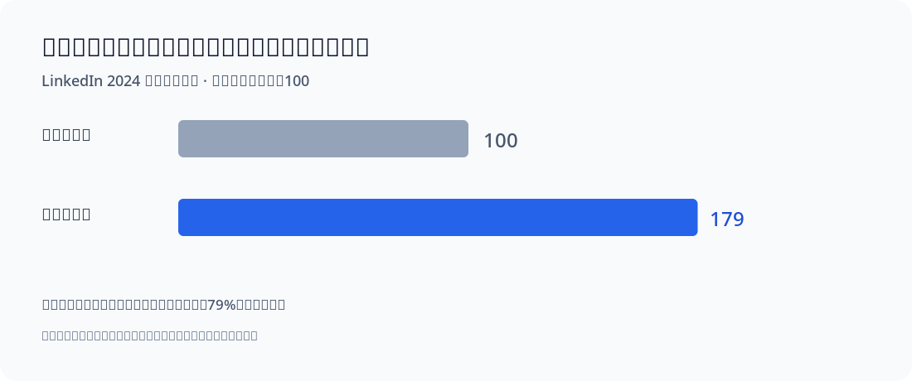

# 两张数据图：核对口径后再解读

图像由本项目依据出处提供的**数字重新绘制**，没有伪装成Gallup、LinkedIn的官方截图。这里给出每个值的原始出处与计算规则。

## 图一：全球管理者敬业度从2022到2025的变化

| 年份 | 全球经理敬业度 | 全球非经理敬业度 |
|---|---:|---:|
| 2022 | 31% | 20% |
| 2023 | 30% | 18% |
| 2024 | 27% | 18% |
| 2025 | 22% | 19% |

原始来源：[Gallup 2026全球职场报告](https://www.gallup.com/workplace/349484/leadership.aspx)，统计的是从业者报告的**engaged**比例。**这不是升职概率**；说明管理岗位所受的环境压力需要被认真考虑。

## 图二：内部流动率不同的企业管理晋升差异

LinkedIn 2024年企业数据分析报告：内部流动率最高十分位企业，**每位员工获得管理岗位晋升次数**比最低十分位高79%。图中将低流动组设为“100”，高组为“179”，属于**相对指标重绘**，不是原文公布的绝对概率，也不是个体晋升成功率。

原始来源：[LinkedIn Talent Solutions 2024](https://www.linkedin.com/business/talent/blog/talent-acquisition/how-internal-mobility-benefits-employers)，主要限制为观察性平台数据、非随机比较；无法判定内部流动本身带来了多少晋升。
